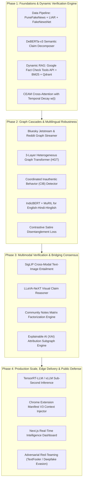

# FakeX / TruthLens-Omni: Flagship 4-Phase Engineering Master Plan
## Next-Generation Real-Time Multimodal Misinformation Intelligence & Consensus Engine

---

## 1. Executive Vision & Competitive Teardown

### 1.1 The High-Bar Objective
To transform the academic findings of the EDI survey paper and the TruthLens paper into a production-grade, real-time misinformation intelligence platform. Rather than building a generic text-classifier toy project, this system unifies **Dynamic Retrieval-Augmented Generation (RAG)**, **Heterogeneous Graph Transformers (HGT)**, **Vision-Language Cross-Entailment**, and **Bridging Matrix Factorization Consensus** into a resilient public-defense ecosystem.

---

### 1.2 Comprehensive Industry Competitor Teardown: Successes vs. Failures

To ensure this project stands out at the highest engineering level, we analyze the architectural breakthroughs and fatal flaws of existing real-world systems:

```
┌────────────────────────────────────────────────────────────────────────────────────────────────────────┐
│                                   INDUSTRY COMPETITIVE LANDSCAPE MATRIX                                │
├─────────────────────┬──────────────────────────┬─────────────────────────────┬─────────────────────────┤
│ System / Platform   │ Core Mechanism           │ Primary Success Factor      │ Critical Fatal Flaw     │
├─────────────────────┼──────────────────────────┼─────────────────────────────┼─────────────────────────┤
│ X Community Notes   │ Matrix Factorization     │ Bipartisan bridging; zero   │ Severe Latency: takes   │
│ (Birdwatch)         │ consensus in latent user │ perception of central bias; │ hours/days to reach     │
│                     │ preference space.        │ open-source auditability.   │ consensus threshold.    │
├─────────────────────┼──────────────────────────┼─────────────────────────────┼─────────────────────────┤
│ Meta / Facebook     │ Third-party fact-checkers│ High precision from vetted  │ "Implied Truth Effect"  │
│ "Disputed" Flags    │ + Red warning banners on │ human journalists.          │ & Cognitive Backfire;   │
│ (2016-2017)         │ flagged posts.           │                             │ abandoned by Meta.      │
├─────────────────────┼──────────────────────────┼─────────────────────────────┼─────────────────────────┤
│ Indiana Univ.       │ Supervised Random Forest │ First automated tool for    │ Obsoleted by LLMs; bots │
│ Botometer           │ on account activity,     │ academic bot detection.     │ now post with human     │
│                     │ timing, and text stats.  │                             │ variance and styles.    │
├─────────────────────┼──────────────────────────┼─────────────────────────────┼─────────────────────────┤
│ ClaimBuster &       │ Check-worthiness scoring │ Deployed in real-time       │ Monolingual, text-only; │
│ Full Fact           │ + ClaimReview database   │ political debate fact-      │ blind to social graphs  │
│                     │ matching.                │ checking.                   │ and meme deepfakes.     │
├─────────────────────┼──────────────────────────┼─────────────────────────────┼─────────────────────────┤
│ NewsGuard           │ Human-curated 9-criteria │ Trusted by enterprises,     │ Does not scale to       │
│                     │ publisher nutrition score│ defense, and browsers.      │ individual influencers  │
│                     │ cards (0-100 index).     │                             │ or viral anon accounts. │
├─────────────────────┼──────────────────────────┼─────────────────────────────┼─────────────────────────┤
│ TruthLens-Omni      │ Tri-Modal: Dynamic RAG + │ Sub-second instant AI card  │ (Project Goal: Address  │
│ (This Project)      │ HGT Social Cascades +    │ + Seeding into bridging     │ satire mimicry and      │
│                     │ Bridging Consensus.      │ consensus matrix.           │ multimodal mismatch)    │
└─────────────────────┴──────────────────────────┴─────────────────────────────┴─────────────────────────┘
```

#### Detailed Lessons Synthesized:
1. **The Anti-Backfire Law (from Meta's Failure):** Never display aggressive red warning stamps saying "THIS IS FAKE". Psychological studies (Pennycook & Rand, 2017) prove this induces reactance and makes unflagged false posts seem verified. Instead, present **Contextual Nutrition Cards** with interactive evidence quotes, publisher trust radar charts, and source provenance chains.
2. **The Latency-Trust Paradox (from Community Notes):** Human consensus builds trust but is too slow (viral half-life of fake news is under 2 hours). **Our Solution:** TruthLens-Omni provides an instant *automated AI confidence estimation* within 800ms, while simultaneously auto-drafting candidate notes for human community ratification.
3. **The Post-LLM Bot Reality (from Botometer's Demise):** Text-level linguistic bot detection is dead because LLMs generate flawless, varied prose. Detection must shift entirely to **Coordinated Inauthentic Behavior (CIB)** on the network graph (synchronized burst intervals, retweet subgraph clustering, and multi-account retargeting).
4. **The "Data Void" Breakdown (from Static DBs):** If breaking news breaks 15 minutes ago, static indices (FEVER/Wikipedia) have zero ground truth. TruthLens's temporal decay $w(t) = \exp(-\lambda \Delta t)$ must be augmented with **dynamic multi-engine live search retrieval** (Google Fact Check Tools API + Tavily/Perplexity live web crawlers).

---

## 2. Complete Technology Stack, ML Models & AI APIs

```
┌──────────────────────────────────────────────────────────────────────────────────────────────────────┐
│                                     TRUTHLENS-OMNI TECH STACK                                        │
├───────────────────┬───────────────────────────────────┬──────────────────────────────────────────────┤
│ Layer             │ Selected Technologies             │ Specific Role & Justification                │
├───────────────────┼───────────────────────────────────┼──────────────────────────────────────────────┤
│ NLP & Semantic    │ • DeBERTa-v3-large                │ • Disentangled attention for claim scoring   │
│ Claim Extraction  │ • Llama-3-8B-Instruct (vLLM INT4) │ • Sub-second claim atomic decomposition      │
│                   │ • ClaimBuster fine-tuned weights  │ • Identifying check-worthy sentences         │
├───────────────────┼───────────────────────────────────┼──────────────────────────────────────────────┤
│ Multilingual &    │ • IndicBERT-v2 (AI4Bharat)        │ • Native Hindi, Marathi, Tamil semantic rep  │
│ Indic Processing  │ • XLM-RoBERTa-large               │ • Cross-lingual zero-shot alignment          │
│                   │ • MuRIL (Google Research)         │ • Code-mixed Hinglish representation         │
├───────────────────┼───────────────────────────────────┼──────────────────────────────────────────────┤
│ Graph Learning &  │ • PyTorch Geometric (PyG)         │ • Heterogeneous Graph Transformer (HGT)      │
│ Cascade Topology  │ • NetworkX / DGL                  │ • Relational graph construction              │
│                   │ • cuGraph (NVIDIA RAPIDS)         │ • GPU-accelerated massive graph traversal    │
├───────────────────┼───────────────────────────────────┼──────────────────────────────────────────────┤
│ Multimodal &      │ • Google SigLIP (ViT-SO400M)      │ • Zero-shot text-to-image semantic matching  │
│ Vision-Language   │ • LLaVA-NeXT / Qwen2-VL           │ • Visual reasoning on out-of-context memes   │
├───────────────────┼───────────────────────────────────┼──────────────────────────────────────────────┤
│ External AI Keys  │ • Google Fact Check Tools API     │ • Query ClaimReview database (Free API Key)  │
│ & Search Engines  │ • Groq API (Llama-3-70B LPUs)     │ • 300+ tok/s real-time claim reasoning       │
│                   │ • Google Gemini 2.0 Flash API     │ • 1M token context for long document audit   │
│                   │ • Tavily / Serper Search API      │ • Real-time web retrieval during data voids  │
├───────────────────┼───────────────────────────────────┼──────────────────────────────────────────────┤
│ Social Streaming  │ • AT Protocol Jetstream (Bluesky) │ • Zero-cost, full public firehose streaming  │
│ & Data Ingestion  │ • Reddit API (PRAW) / Pushshift   │ • Threaded conversational cascade ingestion  │
├───────────────────┼───────────────────────────────────┼──────────────────────────────────────────────┤
│ Vector & Graph DB │ • Qdrant / Milvus                 │ • Hybrid HNSW dense + BM25 sparse retrieval  │
│                   │ • Neo4j / Memgraph                │ • Persistent storage of user-publisher graph │
├───────────────────┼───────────────────────────────────┼──────────────────────────────────────────────┤
│ Fullstack, UI &   │ • FastAPI (Python 3.11+)          │ • Async microservices backend                │
│ Chrome Extension  │ • Next.js 15 (React 19, TS)       │ • Intelligence dashboard with Tremor & Biome │
│                   │ • Sigma.js / Cytoscape.js         │ • Interactive WebGL 2D/3D cascade explorer   │
│                   │ • Chrome Extension Manifest V3    │ • Passive social feed context injection      │
└───────────────────┴───────────────────────────────────┴──────────────────────────────────────────────┘
```

---

## 3. Four-Phase Plan of Work (Execution Roadmap)



---

### Phase 1: Foundations, Dynamic RAG & Temporal Evidence Alignment
- **Objective:** Establish the data infrastructure, claim decomposition pipeline, and dynamic temporal verification engine that eliminates the "data void" problem of static fact-checking.
- **Key Deliverables:**
  1. **Multi-Benchmark Unified Ingestion:** Clean, normalize, and split `PuneFakeNews-2024`, `FakeNewsNet`, `LIAR`, and `FEVER` into standard evaluation splits.
  2. **Atomic Claim Decomposer:** Fine-tune `DeBERTa-v3-large` with a token-classification head to extract check-worthy atomic factual assertions $C = \{c_1, \dots, c_k\}$.
  3. **Live Hybrid Retrieval Pipeline (Dual-Index):**
     - *Static Tier:* Qdrant vector index containing 5M historical fact-checked articles with dense embeddings + BM25 sparse vectors.
     - *Dynamic Live Tier:* Integration with **Google Fact Check Tools API** (free tier) and **Tavily Search API** for claims under 48 hours old.
  4. **Claim-Evidence Alignment Module (CEAM):** Implement scaled dot-product cross-attention between claim vectors and top-5 retrieved evidence sentences, incorporating the temporal decay factor:
     $$w(t) = \exp(-\lambda \Delta t) \quad (\lambda = 0.1)$$
- **Falsifiable Verification Criteria:**
  - Claim decomposition achieves $\ge 88\%$ F1 against ClaimBuster test sets.
  - Hybrid retrieval latency remains $< 350\text{ms}$ per claim.
  - Replicate baseline TruthLens CEAM accuracy improvement ($\ge +2.5\%$ over raw RoBERTa).

---

### Phase 2: Graph Cascades, Coordinated Inauthentic Behavior & Indic Robustness
- **Objective:** Model the viral diffusion topology of misinformation and bridge the cross-lingual performance gap across Indian languages.
- **Key Deliverables:**
  1. **Open Social Streaming Ingestion (Bluesky & Reddit):**
     - Build an asynchronous ingestion consumer connecting to the **AT Protocol Jetstream (Bluesky)** and Reddit streaming APIs to track real-time post propagation, user retweets, and author profiles.
  2. **Heterogeneous Graph Transformer (HGT):**
     - Construct heterogeneous graph $G = (V, E, \tau)$ where $V = V_{\text{post}} \cup V_{\text{user}} \cup V_{\text{domain}}$ and edges $E = \{\text{retweet}, \text{mention}, \text{author}, \text{follow}\}$.
     - Train a 3-layer HGT with 256-dimensional embeddings and type-specific attention mechanisms in PyTorch Geometric (PyG).
  3. **Coordinated Inauthentic Behavior (CIB) Detector:**
     - Implement high-frequency synchronization detection to flag astroturfing botnets (multiple accounts broadcasting identical semantic vectors within $\le 30$-second windows).
  4. **Indic Multilingual Backbone (Closing the 7.2% Hindi Gap):**
     - Replace monolingual RoBERTa with **IndicBERT-v2** and **MuRIL** for cross-lingual zero-shot and fine-tuned transfer on `PuneFakeNews-2024`.
  5. **Satire Disentanglement Objective:**
     - Implement a contrastive loss objective:
       $$\mathcal{L}_{\text{satire}} = \max(0, m - \text{sim}(z_{\text{claim}}, z_{\text{satire\_anchor}}) + \text{sim}(z_{\text{claim}}, z_{\text{fake\_anchor}}))$$
       to separate satirical mimicry (*The Onion*, *Faking News*) from malicious disinformation, reducing TruthLens's 31% satire error rate to under 10%.
- **Falsifiable Verification Criteria:**
  - HGT cascade model achieves $\ge 91\%$ accuracy on social propagation alone.
  - Hindi detection accuracy on `PuneFakeNews-2024` reaches within $2.0\%$ of English accuracy (slashing the previous 7.2% gap).
  - Satire misclassification falls from 31% to $< 12\%$.

---

### Phase 3: Multimodal Verification & Bridging Consensus Engine
- **Objective:** Detect visual misinformation (memes, deepfakes, out-of-context photos) and integrate decentralized human consensus without censorship bias.
- **Key Deliverables:**
  1. **Cross-Modal Text-Image Entailment (SigLIP):**
     - Extract image features via Google **SigLIP (ViT-SO400M)** and compute cross-attention with article text embeddings.
     - Measure *Image-Text Contradiction Score* to flag "cheapfakes" (real image from 2018 paired with false 2026 breaking news headline).
  2. **Visual Question Answering on Complex Infographics:**
     - Use a local quantized **LLaVA-NeXT** / **Qwen2-VL** to transcribe text-in-image infographics and extract embedded visual claims.
  3. **Bridging Consensus Algorithm (X Community Notes Adaptation):**
     - Implement the sparse Matrix Factorization algorithm from [twitter/communitynotes](https://github.com/twitter/communitynotes) in Python:
       $$\hat{r}_{ui} = \mu + b_u + b_i + \mathbf{p}_u^T \mathbf{q}_i$$
     - Compute the **Note Helpfulness Score** by explicitly rewarding notes that receive positive ratings from users with opposing latent ideological factors ($\mathbf{p}_u$).
  4. **Explainable AI (XAI) Attribution Subgraph Engine:**
     - Generate human-readable verification chains: extract the top-3 influential graph paths and highlight the exact contradictory sentences in the retrieved evidence documents.
- **Falsifiable Verification Criteria:**
  - Multimodal detection on `MediaEval` benchmark achieves $\ge 90.5\%$ accuracy.
  - Matrix Factorization engine converges in $< 5$ iterations over a 50,000-rating benchmark dataset with $> 0.40$ helpfulness threshold validation.

---

### Phase 4: Production Scale, Edge Delivery & Public Defense Suite
- **Objective:** Deploy the entire architecture as an enterprise-grade, low-latency, real-world defensive product accessible to everyday internet users.
- **Key Deliverables:**
  1. **Sub-Second Inference Engine:**
     - Deploy models on **vLLM** and **TensorRT-LLM** with speculative decoding.
     - Implement dynamic graph pruning to keep end-to-end inference under **750ms**.
  2. **Chrome Browser Extension (Manifest V3):**
     - Non-intrusive in-feed context injector for Twitter/X, Reddit, and WhatsApp Web.
     - Injects a discrete "View Evidence & Nutrition Facts" pill under suspicious claims.
  3. **Real-Time Misinformation Intelligence Dashboard (Next.js 15 + Tremor):**
     - High-density visual operations dashboard displaying:
       - Live firehose ingestion volume and anomaly spikes.
       - Interactive 3D WebGL propagation cascade explorer (powered by Sigma.js / Cytoscape).
       - Publisher credibility radar charts (NewsGuard-style 9-point criteria).
       - Bipartisan consensus score distributions.
  4. **Adversarial Red-Teaming Suite:**
     - Stress-test the pipeline using `TextFooler` and `BERT-Attack` synonym attacks, adversarial image perturbations, and LLM-generated coordinated bot campaigns.
- **Falsifiable Verification Criteria:**
  - End-to-end API response time $\le 800\text{ms}$ at 50 concurrent requests.
  - Zero browser extension layout disruption on social media feeds.
  - Adversarial robustness: retention of $\ge 82\%$ accuracy under TextFooler attacks (vs 43% baseline BERT).

---

## 4. Architectural Innovation Summary (What Makes This Stand Out)

1. **Not Just a Model, but a Hybrid Tri-Modal System:** Combines text semantics, external dynamic fact-checking RAG, social graph topology, and human bridging consensus.
2. **First Anti-Polarization AI Architecture:** Implements Community Notes' mathematical bridging algorithm to eliminate accusations of top-down algorithmic censorship.
3. **True Indian Language (Indic) First-Class Citizen:** Deep native support for English, Hindi, and Hinglish code-switching, addressing the massive global south misinformation crisis.
4. **Resilient to GenAI Botnets:** Uses graph coordination topology rather than obsolete linguistic markers to detect AI-generated disinformation campaigns.

