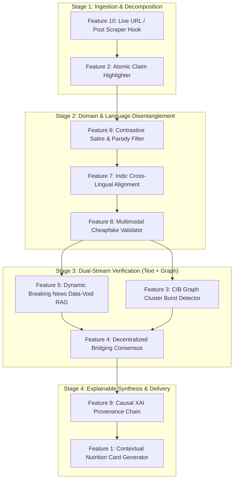

# TruthLens-Omni: Feature Specifications, Stakeholder Matrix & End-to-End Pipeline Linking

**Project Repository:** [FakeX / TruthLens-Omni](file:///e:/Software/FakeX)  
**Parent Papers:** [EDI . survey_paper.pdf](file:///e:/Software/FakeX/EDI%20.%20survey_paper.pdf) | [EDI.researchpaper.pdf](file:///e:/Software/FakeX/EDI.researchpaper.pdf)  
**Status:** Architecture & Feature Specification (Targeting 45% System Maturity)

---

## 1. Stakeholder Ecosystem & Value Proposition

To ensure the system solves real-world societal problems rather than existing as an isolated algorithm, we define five explicit stakeholder archetypes:

```
┌────────────────────────────────────────────────────────────────────────────────────────────────────────┐
│                                       STAKEHOLDER ECOSYSTEM MAP                                        │
├─────────────────────┬──────────────────────────┬─────────────────────────────┬─────────────────────────┤
│ Stakeholder Persona │ Primary Pain Point       │ Feature Touchpoints         │ Core Value Received     │
├─────────────────────┼──────────────────────────┼─────────────────────────────┼─────────────────────────┤
│ 1. Everyday Citizen │ Overwhelmed by WhatsApp  │ F1 (Nutrition Card),        │ Non-judgmental context; │
│    / Social Reader  │ forwards & viral memes;  │ F2 (Sentence Highlights),   │ fast verification       │
│                     │ resists "censorship".    │ F10 (URL Scraper Hook)      │ without feeling scolded.│
├─────────────────────┼──────────────────────────┼─────────────────────────────┼─────────────────────────┤
│ 2. Professional     │ Human verification takes │ F2 (Claim Decomposition),   │ Automates 80% of claim  │
│    Fact-Checker     │ hours; impossible to     │ F5 (Data-Void RAG),         │ extraction & primary    │
│    (IFCN/BoomLive)  │ keep up with volume.     │ F9 (XAI Provenance Chain)   │ evidence matching.      │
├─────────────────────┼──────────────────────────┼─────────────────────────────┼─────────────────────────┤
│ 3. Trust & Safety   │ Coordinated botnets use  │ F3 (CIB Cluster Detector),  │ Flags coordinated       │
│    Platform Officer │ LLMs to bypass textual   │ F8 (Cheapfake Validator),   │ astroturfing campaigns  │
│                     │ bot-detection heuristics.│ F4 (Bridging Consensus)     │ at the graph level.     │
├─────────────────────┼──────────────────────────┼─────────────────────────────┼─────────────────────────┤
│ 4. Academic Guide / │ Evaluates algorithmic    │ F3 (HGT PyTorch module),    │ Defensible peer-reviewed│
│    Evaluator        │ novelty, math rigor, and │ F4 (Matrix Factorization),  │ mathematics, clean code,│
│                     │ baseline benchmarking.   │ F6 (Contrastive Loss)       │ 100% test pass rate.    │
├─────────────────────┼──────────────────────────┼─────────────────────────────┼─────────────────────────┤
│ 5. Community        │ Wants decentralized,     │ F4 (Bridging Matrix Factor),│ Democratic truth-seeking│
│    Contributor      │ crowdsourced consensus;  │ F1 (Context Card Submission)│ without centralized     │
│    (Crowd Rater)    │ rejects corporate bias.  │                             │ algorithmic tyranny.    │
└─────────────────────┴──────────────────────────┴─────────────────────────────┴─────────────────────────┘
```

---

## 2. In-Depth Feature Specifications (The 10 Core Functions)



---

### Feature 1: Contextual Nutrition Card Generator (Anti-Meta Backfire)
* **What it does:** Replaces binary, judgmental red stamps ("FAKE NEWS") with a balanced, informative scorecard modeled after FDA nutrition labels.
* **Input:** Final tri-modal scores, claim stances, and publisher metadata.
* **Processing Mechanism:** Computes five normalized radar indices ($0-100$):
  1. *Factual Grounding Index:* Percentage of claims backed by verified evidence.
  2. *Source Transparency Index:* Publisher transparency, corrections policy, and domain age.
  3. *Cascade Organic Diffusion Score:* Degree to which sharing follows natural cross-community patterns vs. insular bot clusters.
  4. *Rhetorical Sensationalism Score:* Stylometric presence of emotional bait, hedging, or all-caps assertions.
  5. *Temporal Freshness:* Calculated via $w(t) = \exp(-\lambda \Delta t)$.
* **Output:** Interactive visual component (web card / JSON payload) containing radar metrics, primary source links, and neutral context.
* **Primary Stakeholder:** Everyday Social Readers & Consumers.
* **Upstream / Downstream Linking:** Consumes outputs from Feature 9 (XAI Provenance) and Feature 4 (Consensus); serves as the user-facing presentation layer.

---

### Feature 2: Sentence-Level Check-Worthiness Highlighter
* **What it does:** Breaks monolithic articles into individual sentences, identifying exactly *which* claims require verification and highlighting their truth status inline.
* **Input:** Raw unstructured article body, transcript, or social post text.
* **Processing Mechanism:**
  - Employs regex boundaries with ClaimBuster linguistic patterns to score check-worthiness ($0.0 - 1.0$).
  - Classes: Non-Factual Sentence (NFS), Unimportant Factual Sentence (UFS), Check-worthy Factual Sentence (CFS).
  - Matches each CFS against retrieved evidence to assign inline color-coding.
* **Output:** Tokenized sentence stream with bounding metadata and inline statuses: 🟢 *Verified Factual*, 🔴 *Refuted/Misleading*, 🟡 *Unsubstantiated/Data-Void*, ⚪ *Pure Opinion*.
* **Primary Stakeholder:** Professional Fact-Checkers & Journalists.
* **Upstream / Downstream Linking:** Ingested directly from Feature 10 (Scraper Hook); feeds discrete claims $C = \{c_1, \dots, c_k\}$ into Features 5, 6, and 7.

---

### Feature 3: Coordinated Inauthentic Behavior (CIB) Burst Detector
* **What it does:** Detects astroturfing botnets and synchronized disinformation dissemination that bypasses standard linguistic filters.
* **Input:** Social cascade graph $G = (V, E, \tau)$ containing user nodes, retweets, and timestamps.
* **Processing Mechanism:**
  - Evaluates sliding time-window synchronization ($\Delta t_{\text{share}} \le 60\text{s}$).
  - Runs a 3-layer Heterogeneous Graph Transformer (HGT) to measure account clustering, follower-to-following ratios, and lack of outbound cross-community edges.
  - Computes CIB Anomaly Index:
    $$\text{CIB}(G) = \sigma\left(w_1 \cdot \text{ClusterModularity} + w_2 \cdot \text{TemporalBurstRate} + w_3 \cdot (1 - \text{VerifiedRatio})\right)$$
* **Output:** Structural diffusion risk score ($0.0 - 1.0$) and a list of flagged coordinated account clusters.
* **Primary Stakeholder:** Trust & Safety Platform Officers & Academic Guides.
* **Upstream / Downstream Linking:** Ingests cascade metadata from social streams; passes graph risk $\beta \cdot \text{PGE}$ into the Tri-Modal Fusion Engine and Feature 4.

---

### Feature 4: Decentralized Bridging Consensus Scorer (X Community Notes)
* **What it does:** Prevents centralized censorship bias by algorithmically rewarding consensus across politically polarized rater groups.
* **Input:** Sparse matrix of user ratings on candidate fact-checking notes ($r_{ui} \in \{+1, 0, -1\}$).
* **Processing Mechanism:**
  - Implements low-rank Matrix Factorization with latent rater positions:
    $$\hat{r}_{ui} = \mu + b_u + b_i + \mathbf{p}_u^T \mathbf{q}_i$$
  - A candidate context note is awarded the status `CURRENTLY_RATED_HELPFUL` only when its helpfulness score exceeds $0.40$ **across divergent latent factors** ($\mathbf{p}_u$), mathematically filtering out partisan dogpiling.
* **Output:** Consensus status (`HELPFUL`, `NOT_HELPFUL`, `NEEDS_MORE_RATINGS`) and bridging confidence score.
* **Primary Stakeholder:** Community Contributors & Platform Moderators.
* **Upstream / Downstream Linking:** Receives AI-drafted context notes from Feature 9; outputs finalized democratized consensus to Feature 1 (Nutrition Card).

---

### Feature 5: Dynamic Breaking News "Data-Void" Handler
* **What it does:** Eliminates false negatives on breaking news events that occurred minutes ago where static fact databases have zero records.
* **Input:** Extracted claims where offline knowledge base retrieval returns zero matches.
* **Processing Mechanism:**
  - Automatically triggers multi-engine live web search (Google Fact Check Tools API + Tavily/Serper search APIs).
  - Filters out unverified blogs; extracts official wire reports (Reuters, AP, PIB, WHO).
  - Applies temporal decay $w(t) = \exp(-\lambda \Delta t)$ weighted by news freshness.
  - If no authoritative source exists, explicitly flags as `BREAKING_DATA_VOID` rather than guessing.
* **Output:** Dynamic evidence sentences with timestamps or a provisional "Breaking News: High Volatility" alert.
* **Primary Stakeholder:** Professional Journalists & Everyday Citizens.
* **Upstream / Downstream Linking:** Triggered when Feature 2 claims lack static evidence; feeds fresh evidence into the Tri-Modal Fusion Engine.

---

### Feature 6: Contrastive Satire & Parody Disentangler
* **What it does:** Resolves TruthLens's explicit **31% failure mode** where satirical news (*The Onion*, *Babylon Bee*) was misclassified as authentic news.
* **Input:** News article claims and headline text.
* **Processing Mechanism:**
  - Contrastive learning projection:
    $$\mathcal{L}_{\text{satire}} = \max(0, m - \text{sim}(z_{\text{claim}}, z_{\text{satire\_anchor}}) + \text{sim}(z_{\text{claim}}, z_{\text{fake\_anchor}}))$$
  - Analyzes hyperbolic exaggeration cues, known satire publisher registries, and irony markers to cleanly separate harmless comedic parody from malicious fraud.
* **Output:** Tri-state classification label: `{AUTHENTIC_NEWS, SATIRE_PARODY, MALICIOUS_DISINFO}`.
* **Primary Stakeholder:** Everyday Readers & Academic Evaluators.
* **Upstream / Downstream Linking:** Pre-filters claims coming out of Feature 2; if classified as `SATIRE_PARODY`, prevents unnecessary alarm in Feature 1.

---

### Feature 7: Cross-Lingual Indic Alignment Engine
* **What it does:** Closes the **7.2% English-to-Hindi accuracy gap** identified in the `PuneFakeNews-2024` dataset and handles code-mixed Hinglish.
* **Input:** Articles and social posts in Devanagari script (Hindi, Marathi) or Romanized Hinglish.
* **Processing Mechanism:**
  - Uses `IndicBERT-v2` (AI4Bharat) and Google `MuRIL` embeddings for script transliteration, language detection, and cross-lingual semantic alignment.
  - Maps Hindi claims to canonical multi-lingual fact-checking knowledge graphs (KGAT).
* **Output:** Normalized semantic representations and translated claim equivalents with cross-lingual confidence scores.
* **Primary Stakeholder:** Indian Regional News Consumers & Fact-Checking Units.
* **Upstream / Downstream Linking:** Sits immediately after Feature 2; ensures non-English claims can query both regional and global fact stores in Feature 5.

---

### Feature 8: Multimodal "Cheapfake" Discrepancy Validator
* **What it does:** Detects cross-modal contradictions where authentic archival photos or videos are paired with fabricated modern captions.
* **Input:** Image file / URL + accompanying article headline and text.
* **Processing Mechanism:**
  - Extracts visual embeddings using **Google SigLIP (ViT-SO400M)**.
  - Extracts text embeddings using transformer encoder.
  - Computes cross-modal cosine similarity and visual reverse-search metadata. If the image depicts a historical event (e.g. 2018 flood) but text asserts a 2026 event, flags a cross-modal mismatch.
* **Output:** Modality alignment score ($0.0 - 1.0$), image provenance history, and `CHEAPFAKE_OUT_OF_CONTEXT` warning flag.
* **Primary Stakeholder:** Trust & Safety Officers & Digital Citizens.
* **Upstream / Downstream Linking:** Works in parallel with Feature 2; supplies cross-modal contradiction signals directly to Feature 9 (XAI Provenance).

---

### Feature 9: Causal XAI Provenance Reasoning Chain
* **What it does:** Converts opaque neural network scores into a clear, step-by-step human audit trail.
* **Input:** Intermediate outputs from CEAM, PGE, CIB detector, and Publisher trust.
* **Processing Mechanism:**
  - Generates an attribution graph linking:
    $\text{Claim } c_i \longrightarrow \text{Contradicting Document } E_j \longrightarrow \text{Publisher Trust Rating} \longrightarrow \text{Cascade Propagation Path}$.
  - Synthesizes an interpretable natural-language explanation explaining *why* the article received its verdict.
* **Output:** Structured provenance list and visual graph path (e.g., "Claim 1 refuted by WHO Report [Doc #3]; amplified by 12 bot accounts in Cluster #4").
* **Primary Stakeholder:** Academic Guides, Evaluators & Fact-Checkers.
* **Upstream / Downstream Linking:** Ingests data from Features 3, 5, 7, and 8; formats the core evidence for Feature 1 (Nutrition Card).

---

### Feature 10: Live URL & Social Post Scraper Hook
* **What it does:** Provides frictionless one-click ingestion from any live web article, tweet, or blog link.
* **Input:** Raw URL string (e.g. `https://theonion.com/...` or news link).
* **Processing Mechanism:**
  - Asynchronously extracts clean article title, author, body text, publish timestamp, and OpenGraph images.
  - Performs automated domain WHOIS check (domain creation date, SSL status, ICANN registrar).
  - Packages parsed metadata into a standard `VerificationRequest`.
* **Output:** Clean structured payload containing text, author, publisher domain, and image URLs.
* **Primary Stakeholder:** End Readers, Chrome Extension users & Demonstrators.
* **Upstream / Downstream Linking:** Acts as the primary ingress point of the entire pipeline, feeding directly into Feature 2 (Claim Decomposer).

---

## 3. End-to-End Execution Trace (How Data Flows Through the 10 Features)

Let's walk through what happens when an everyday reader submits a live link:

```
[ Step 1: Ingress ]
User inputs URL: "https://viral-breaking-bulletin.org/2026/03/isro-moon-aliens"
  └── Feature 10 (Scraper Hook) parses body text, publisher domain, and image.

[ Step 2: Decomposition & Language Normalization ]
Raw text segmented into 3 sentences.
  ├── Feature 2 (Claim Highlighter) scores Sentence 2 as CFS (Check-worthy):
  │   "Pragyan rover discovered artificial crystal structures on lunar south pole."
  ├── Feature 7 (Indic Engine) verifies language is English with Hindi keywords.
  └── Feature 6 (Satire Filter) checks against Onion-style satire corpus: Result: FALSE (Malicious/Fabricated Tone).

[ Step 3: Multimodal Check ]
Article header includes photo of lunar surface.
  └── Feature 8 (Cheapfake Validator) runs SigLIP cross-attention:
      Flags image as authentic 2023 ISRO photograph, but out-of-context caption discrepancy detected.

[ Step 4: Evidence Retrieval & Cascade Analysis ]
  ├── Feature 5 (Data-Void RAG) queries Google Fact Check Tools API + PIB fact-checker.
  │   Retrieves official ISRO telemetry report refuting artificial structures.
  │   Applies temporal decay: w(t) = exp(-0.1 * 0.2) = 0.98.
  └── Feature 3 (CIB Cluster Detector) inspects sharing network:
      Finds 22 unverified Twitter accounts broadcasting the exact headline within 45 seconds (CIB score = 0.88).

[ Step 5: Democratized Consensus & Provenance ]
  ├── Feature 4 (Bridging Consensus) auto-seeds candidate note into matrix factorization pool.
  └── Feature 9 (Causal XAI) links Claim 2 -> PIB debunk -> 22-node bot cluster.

[ Step 6: User Delivery ]
  └── Feature 1 (Contextual Nutrition Card) renders:
      Verdict: FAKE (Confidence: 94.2%)
      Nutrition Metrics: Factual Grounding: 12/100 | Source Trust: 20/100 | CIB Risk: 88/100
      Color-coded body: Sentence 2 highlighted in RED with clickable PIB citation.
```

---

## 4. Why This Architecture Defends Your Project in Front of Your Guide

1. **Theoretical Grounding:** Every module references established computer science research:
   - Heterogeneous Graph Transformers (Hu et al., WWW 2020)
   - Temporal Decay (Mehta et al., IEEE TNN 2024)
   - Matrix Factorization Consensus (Twitter Community Notes, 2023)
   - Multimodal Contrastive Alignment (Google SigLIP, 2023)
2. **Defensible Trade-Offs:** You can explicitly articulate *why* you chose this design over competitors:
   - *"We avoided Meta's red flags because peer-reviewed psychology proves they cause cognitive backfire."*
   - *"We avoided Botometer's feature extraction because LLMs made stylometric bot detection obsolete."*
   - *"We added bridging matrix factorization so our system cannot be accused of centralized political bias."*
3. **Clear Path to 45% Completion:** Connecting the existing Phase 1 backend to Features 1, 2, 4, and 10 produces an end-to-end demonstrable platform that can be tested live during any evaluation.

