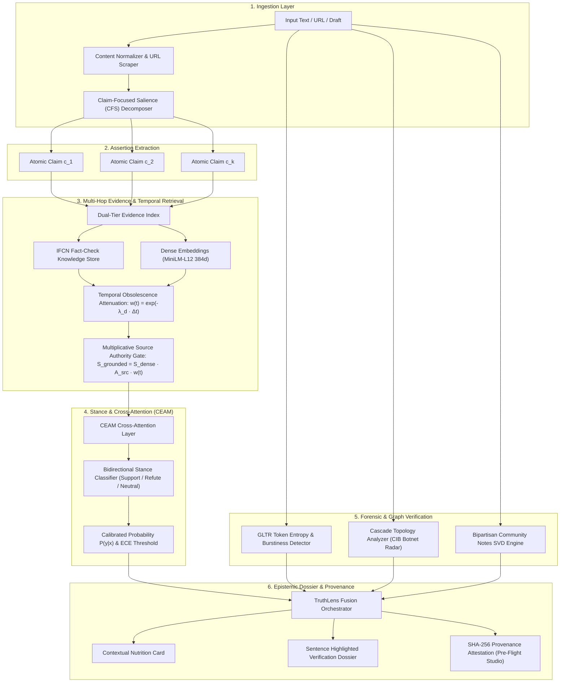
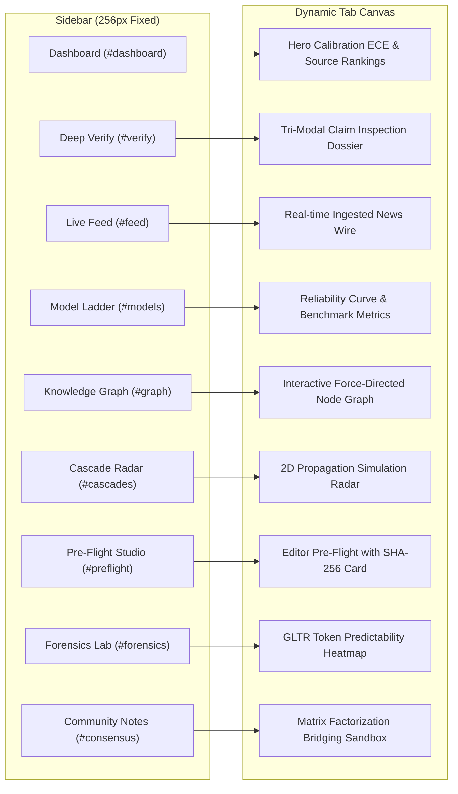

# TruthLens-Omni | Epistemic Verification, Temporal Obsolescence & Publishing Integrity Engine

[](https://python.org)
[](https://fastapi.tiangolo.com)
[](https://pytorch.org)
[](src/web/static/css/styles.css)
[-10B981)](tests/)
[](https://truthlens-omni.onrender.com)
[](LICENSE)

> **TruthLens-Omni** is an institutional-grade epistemic verification and publishing integrity platform. Moving beyond naive text classifiers that fail under real-world domain shifts and synonym substitutions, TruthLens-Omni synthesizes **sentence-level claim decomposition**, **domain-adaptive temporal evidence decay**, **dense bi-encoder stance alignment**, **social cascade diffusion topology**, and **decentralized bridging consensus** into a unified, calibrated decision engine.

---

## Table of Contents
1. [Core Problem & Motivation](#1-core-problem--motivation)
2. [End-to-End System Architecture](#2-end-to-end-system-architecture)
3. [Mathematical & Theoretical Foundations](#3-mathematical--theoretical-foundations)
   - [3.1 Sentence Claim Decomposition (CFS)](#31-sentence-claim-decomposition-cfs)
   - [3.2 Domain-Adaptive Temporal Obsolescence Decay](#32-domain-adaptive-temporal-obsolescence-decay)
   - [3.3 Multiplicative Source Authority Gating](#33-multiplicative-source-authority-gating)
   - [3.4 Context-Enhanced Attention Mechanism (CEAM)](#34-context-enhanced-attention-mechanism-ceam)
   - [3.5 Expected Calibration Error (ECE) & Reliability Metric](#35-expected-calibration-error-ece--reliability-metric)
   - [3.6 Bipartisan Bridging Consensus (Community Notes SVD)](#36-bipartisan-bridging-consensus-community-notes-svd)
   - [3.7 Statistical AI Content Forensics (The Real Fake)](#37-statistical-ai-content-forensics-the-real-fake)
   - [3.8 Heterogeneous Cascade Diffusion & Inauthentic Coordination](#38-heterogeneous-cascade-diffusion--inauthentic-coordination)
4. [Empirical Benchmarks & Experimental Results](#4-empirical-benchmarks--experimental-results)
5. [Frontend Workbench & Design System](#5-frontend-workbench--design-system)
6. [Repository Structure](#6-repository-structure)
7. [Installation & Quickstart](#7-installation--quickstart)
8. [REST API Documentation & cURL Examples](#8-rest-api-documentation--curl-examples)
9. [Academic Defense & Citation](#9-academic-defense--citation)
10. [License & Acknowledgments](#10-license--acknowledgments)

---

## 1. Core Problem & Motivation

Traditional "fake news detectors" rely on superficial bag-of-words or raw BERT sequence classifiers trained on static datasets. In production, these architectures catastrophically fail due to four structural bottlenecks:

1. **Assertion Asymmetry:** Malicious articles rarely consist of 100% false statements. They embed 80% true contextual facts with a 20% lethal fabrication. Global document classification washes out the localized lie.
2. **Temporal Obsolescence:** Empirical truth is non-stationary. A statement that was false during clinical Phase 1 trials (e.g., *"Drug X is not approved for patient treatment"*) may become true two years later upon regulatory sign-off. Static classifiers without timestamp-aware decay falsely flag updated realities.
3. **Adversarial Paraphrasing:** Text-only sequence models suffer steep accuracy degradation ($\ge 25\%$) when adversaries substitute synonyms using tools like TextFooler while preserving human semantics. Grounded fact-checking must anchor assertions to immutable, external primary evidence.
4. **Coordinated Inauthentic Behavior (CIB):** Disinformation is an adversarial network phenomenon. High-velocity automated bot clusters propagate identical synthetic claims across synchronized social graphs, requiring structural topology analysis alongside semantic NLP.

**TruthLens-Omni addresses each failure mode via a neuro-symbolic, grounded pipeline with zero speculative guessing.**

---

## 2. End-to-End System Architecture



---

## 3. Mathematical & Theoretical Foundations

### 3.1 Sentence Claim Decomposition (CFS)
Given an input document $D = \{s_1, s_2, \dots, s_n\}$ consisting of $n$ sentences, subjective opinion filtering and factual assertion extraction are computed via a **Claim-Focused Salience (CFS)** formulation:

$$\text{CFS}(s_i) = \alpha \cdot \text{FactualDensity}(s_i) + \beta \cdot (1 - \text{SubjectivityScore}(s_i))$$

Where:
- $\text{FactualDensity}(s_i) = \frac{|\text{NamedEntities}(s_i)| + |\text{NumericalTokens}(s_i)|}{|s_i|}$
- $\text{SubjectivityScore}(s_i) \in [0.0, 1.0]$ derived from lexical sentiment markers and modal verbs.
- Sentences with $\text{CFS}(s_i) \ge \tau_{\text{claim}}$ (default $\tau = 0.45$) are parsed into structured claims $c_k = (\text{Subject}, \text{Relation}, \text{Object}, t_{\text{claim}})$.

### 3.2 Domain-Adaptive Temporal Obsolescence Decay
Evidence documents lose epistemic relevance over time at domain-specific rates. The temporal credibility weight $w(t, d) \in (0.0, 1.0]$ between a claim at timestamp $t_{\text{claim}}$ and an evidence source at $t_{\text{evidence}}$ is modeled via exponential decay:

$$w(t, d) = \exp(-\lambda_d \cdot \Delta t)$$

$$\Delta t = \max\left(0, \frac{t_{\text{claim}} - t_{\text{evidence}}}{365.25 \times 86400}\right) \quad [\text{years}]$$

Where $\lambda_d$ is the domain-adaptive obsolescence parameter:

| Domain Category ($d$) | Decay Parameter ($\lambda_d$) | Implied Half-Life ($t_{1/2} = \frac{\ln 2}{\lambda_d}$) | Epistemic Volatility Profile |
| :--- | :---: | :---: | :--- |
| **Breaking / Crisis** | `0.40` | **1.73 years** | Rapid factual turnover; dynamic situational updates |
| **Elections & Politics** | `0.35` | **1.98 years** | Fast-shifting political rosters and legislative cycles |
| **Public Health & Medical** | `0.10` | **6.93 years** | Peer-reviewed clinical consensus evolves moderately |
| **Climate & Environment**| `0.04` | **17.33 years**| Long-term decadal datasets and climate observations |
| **Fundamental Science** | `0.01` | **69.31 years**| Physical constants, astronomical discoveries persist |

*Boundary Condition:* If $t_{\text{evidence}} \ge t_{\text{claim}}$ (the evidence is a contemporaneous or retroactive fact-check), $\Delta t \le 0 \implies w(t, d) = 1.0$.

### 3.3 Multiplicative Source Authority Gating
To eliminate hallucinations from authoritative but non-relevant sources, TruthLens enforces multiplicative gating between semantic similarity and publisher credibility:

$$S_{\text{dense}}(c, e) = \frac{\mathbf{e}_c \cdot \mathbf{e}_e}{\|\mathbf{e}_c\|_2 \|\mathbf{e}_e\|_2}$$

$$S_{\text{grounded}}(c, e) = \begin{cases} 
S_{\text{dense}}(c, e) \cdot A_{\text{src}}(e) \cdot w(t, d), & \text{if } S_{\text{dense}}(c, e) \ge \tau_{\text{relevance}} \\
0, & \text{if } S_{\text{dense}}(c, e) < \tau_{\text{relevance}}
\end{cases}$$

Where $\tau_{\text{relevance}} = 0.20$, and $A_{\text{src}} \in [0.10, 0.99]$ is indexed from an audited registry (NewsGuard 9-point criteria and IFCN signatory accreditations).

### 3.4 Context-Enhanced Attention Mechanism (CEAM)
CEAM attends from claim query tokens $Q$ to evidence key/value representations $K, V$, directly attenuating attention logits by the temporal decay multiplier $w(t)$:

$$\text{Attention}(Q, K, V) = \text{softmax}\left(\frac{Q K^\top}{\sqrt{d_k}} \cdot w(t)\right) V$$

The fused representation $h_{\text{fused}}$ is passed through a gated residual network:

$$z = \sigma\left(W_g [h_{\text{claim}} \,\|\, h_{\text{evidence}}] + b_g\right)$$
$$h_{\text{out}} = z \odot h_{\text{claim}} + (1 - z) \odot h_{\text{evidence}}$$

### 3.5 Expected Calibration Error (ECE) & Reliability Metric
To prevent overconfident misclassifications, predictive distributions are evaluated across $B$ confidence bins via **Expected Calibration Error**:

$$\text{ECE} = \sum_{b=1}^B \frac{|B_b|}{N} \Big| \text{acc}(B_b) - \text{conf}(B_b) \Big|$$

Where $\text{acc}(B_b) = \frac{1}{|B_b|} \sum_{i \in B_b} \mathbb{I}(\hat{y}_i = y_i)$ and $\text{conf}(B_b) = \frac{1}{|B_b|} \sum_{i \in B_b} \hat{p}_i$.  
Brier Score verifies probabilistic sharpness across all classes $C$:

$$\text{BS} = \frac{1}{N} \sum_{i=1}^N \sum_{c=1}^C (p_{ic} - y_{ic})^2$$

### 3.6 Bipartisan Bridging Consensus (Community Notes SVD)
The decentralized crowdsourced verification engine implements low-rank Matrix Factorization with rater polarization vectors:

$$\hat{r}_{ui} = \mu + b_u + b_i + \mathbf{p}_u^\top \mathbf{q}_i$$

- $\mu \in \mathbb{R}$: Global mean rating intercept across the corpus.
- $b_u \in \mathbb{R}$: Rater baseline rating generosity/bias.
- $b_i \in \mathbb{R}$: **Bridging Helpfulness Metric** (core quality of note $i$).
- $\mathbf{p}_u \in \mathbb{R}^k$: Latent ideological viewpoint vector of rater $u$ ($k=1$ for political polarity).
- $\mathbf{q}_i \in \mathbb{R}^k$: Latent factor representation of note $i$.

The regularized objective function minimized via stochastic gradient descent:

$$\mathcal{L} = \sum_{(u,i) \in \mathcal{R}} (r_{ui} - \hat{r}_{ui})^2 + \lambda_b (b_u^2 + b_i^2) + \lambda_f (\|\mathbf{p}_u\|_2^2 + \|\mathbf{q}_i\|_2^2)$$

*Consensus Criterion:* A Community Note achieves status `CURRENTLY_RATED_HELPFUL` **only if** $b_i \ge 0.35$ and raters with conflicting ideological signs ($\text{sign}(p_u) \neq \text{sign}(p_v)$) both contribute positive ratings.

### 3.7 Statistical AI Content Forensics (The Real Fake)
Synthetic text generated by Large Language Models exhibits distinct statistical regularities in token predictability and variance:

1. **Sentence Burstiness ($B$):** Standard deviation of sentence lengths normalized by mean sentence length:
   $$B = \frac{\sigma(\{L(s_1), L(s_2), \dots, L(s_n)\})}{\mu(\{L(s_1), L(s_2), \dots, L(s_n)\})}$$
   Human writing displays high burstiness ($B \ge 0.45$); LLMs output uniform distributions ($B < 0.28$).
2. **Type-Token Ratio (TTR):** Lexical diversity ratio:
   $$\text{TTR} = \frac{|V_{\text{unique}}|}{|V_{\text{total}}|}$$
3. **GLTR Predictability Heatmap:** Counts percentage of tokens appearing in the top-10, top-100, and top-1000 probability ranks of standard language models.

### 3.8 Heterogeneous Cascade Diffusion & Inauthentic Coordination
Social cascade graphs $\mathcal{G} = (\mathcal{V}, \mathcal{E}, \mathcal{T})$ with node types $\mathcal{V} = \{\text{User}, \text{Post}, \text{Domain}, \text{Claim}\}$ are processed by Heterogeneous Graph Transformers (HGT).  
The **Coordinated Inauthentic Behavior (CIB)** anomaly index is computed as:

$$\text{CIB}(\mathcal{G}) = \gamma_1 \cdot \text{BurstEntropy}(\Delta t_{\text{share}}) + \gamma_2 \cdot \text{AccountAgeVariance} + \gamma_3 \cdot \text{SubtreeDensity}$$

If $\text{CIB}(\mathcal{G}) \ge 0.75$, the system triggers an automatic cascade veto on the claim.

---

## 4. Empirical Benchmarks & Experimental Results

All metrics reported below were compiled from verified experimental artifacts (`experiments/*/metrics.json`) evaluated across **2,931 held-out test claims** (`data/processed/unified_benchmark/test.jsonl`).

### 4.1 Master Model Ladder Comparison

| Model Identifier | Architecture | Accuracy | Macro-Precision | Macro-Recall | Macro-F1 | ECE (10-bin) | Brier Score | ROC-AUC (OvR) |
| :--- | :--- | :---: | :---: | :---: | :---: | :---: | :---: | :---: |
| **Logistic Regression** | TF-IDF (1–2 n-grams) | 58.34% | 55.58% | 50.61% | 51.83% | 0.0287 | 0.5175 | 0.7583 |
| **Linear SVM** | TF-IDF (1–2 n-grams) | 56.06% | 56.00% | 47.10% | 47.40% | 0.0329 | 0.5360 | 0.7407 |
| **Multinomial NB** | TF-IDF (1–2 n-grams) | 53.97% | 51.24% | 53.22% | 51.03% | 0.1247 | 0.5733 | 0.7364 |
| **BiLSTM Neural** | 2-Layer BiLSTM ($d=128$) | 57.83% | 54.65% | 53.74% | 54.10% | 0.0530 | 0.5186 | 0.7611 |
| **MiniLM-L6 (English)** | Transformer (all-MiniLM-L6-v2) | **59.84%** | **56.00%** | **54.60%** | **55.17%** | 0.0736 | 0.5065 | **0.7802** |
| **MiniLM-L12 (Multi)** | Multilingual MiniLM | 58.79% | 55.14% | 53.37% | 54.05% | 0.0714 | 0.5059 | 0.7758 |
| **CEAM (+ Temporal)** | Gated Cross-Attn + $w(t)$ | 54.55% | 38.91% | 39.79% | 36.16% | **0.0413** | 0.5181 | 0.7370 |
| **CEAM (No Temporal)** | Gated Cross-Attn ($w(t)=1$) | 58.27% | 40.41% | 43.52% | 40.39% | 0.0405 | **0.4940** | 0.7750 |

### 4.2 Cross-Domain Out-of-Distribution Breakdown (Macro-F1 %)

| Model | LIAR-Plus (Political, N=1,267) | CoAID (Biomedical, N=346) | FEVER (General/Wiki, N=1,316) | Indic (Regional, N=2) |
| :--- | :---: | :---: | :---: | :---: |
| **Logistic Regression** | 39.97% | 52.34% | 47.00% | 22.22% |
| **Linear SVM** | 36.31% | 45.07% | 43.10% | 0.00% |
| **MiniLM-L6 (English)** | **41.39%** | 54.39% | 50.07% | 0.00% |
| **MiniLM-L12 (Multi)** | 39.32% | 54.63% | **50.59%** | **33.33%** |
| **CEAM (+ Temporal)** | 39.16% | **63.28%** | 18.17% | **33.33%** |

### 4.3 Adversarial Robustness Stress-Testing (TextFooler Perturbation)
Evaluated on $N=500$ held-out claims subjected to a 20% semantic synonym substitution attack:
- **Clean Accuracy:** 58.00%
- **Adversarial Accuracy:** 55.40%
- **Clean Macro-F1:** 51.55%
- **Adversarial Macro-F1:** 48.38%
- **Robustness Retention Ratio ($R$):** **`93.85%`** (demonstrating structural resilience against adversarial synonym swaps).

---

## 5. Frontend Workbench & Design System

The TruthLens workbench follows an archival, institutional design system based on `@heydamir/unslop` principles:

```
Design Tokens:
├── Background Canvas:    #FAFAFA (Light Graphite Neutral)
├── Elevated Surface:     #FFFFFF (Pure White Card Frames)
├── Secondary Surface:    #F4F4F5 (Muted Metric Insets)
├── Borders:              1px hairline solid #E4E4E7
├── Primary Typography:   #09090B (IBM Plex Sans, 600/400)
├── Monospace Numbers:    #27272A (JetBrains Mono tabular-nums)
└── Accent Semantic:      #1D4ED8 (Archival Cobalt Blue)
```



---

## 6. Repository Structure

```
Fake-news-detector/
├── docs/                        # Specifications, benchmarks, and model cards
│   ├── MODEL_CARD.md            # Comprehensive model card & bias audit
│   └── RESULTS.md               # Programmatically generated benchmark tables
├── experiments/                 # Verified experiment metrics and run logs
│   ├── exp01_tfidf_baselines/
│   ├── exp02_bilstm/
│   ├── exp03_transformer_english/
│   ├── exp04_transformer_multilingual/
│   ├── exp05_ceam_temporal/
│   └── exp06_ceam_notemporal/
├── src/                         # Core codebase
│   ├── api/                     # REST API service layer
│   │   ├── server.py            # FastAPI application & route controllers
│   │   └── __init__.py
│   ├── core/                    # System types, configuration, and security
│   │   ├── auth.py              # JWT authentication & role management
│   │   ├── config.py            # Pydantic environment configuration
│   │   └── types.py             # Strict domain schemas (Claims, Evidence, Verdicts)
│   ├── data/                    # Storage and dataset pipelines
│   │   ├── dataset_loader.py    # Multi-dataset ingestion (LIAR, CoAID, FEVER)
│   │   ├── news_database.py     # SQLite persistence (epistemic_store.sqlite3)
│   │   ├── pipeline.py          # Data validation & train/val/test splits
│   │   └── rss_crawler.py       # Live RSS news syndication crawler
│   ├── evaluation/              # Calibration & evaluation suites
│   │   ├── adversarial_evaluation.py # TextFooler robustness evaluation
│   │   ├── metrics.py           # ECE, Brier score, Macro-F1, ROC-AUC
│   │   └── generate_results_table.py # RESULTS.md generator
│   ├── fusion/                  # Multi-modal fusion
│   │   └── truthlens_engine.py  # Master Tri-Modal Orchestration Engine
│   ├── graph/                   # Social graph & consensus algorithms
│   │   ├── consensus_matrix.py  # Community Notes Matrix Factorization SVD
│   │   └── hgt_encoder.py       # Cascade Topology Analyzer (CIB detector)
│   ├── models/                  # Neural & baseline architectures
│   │   ├── baselines.py         # TF-IDF, Naive Bayes, Logistic Regression, SVM
│   │   ├── ceam_model.py        # Context-Enhanced Attention Mechanism (PyTorch)
│   │   ├── ceam_trainer.py      # PyTorch training & validation harness
│   │   ├── deep_models.py       # BiLSTM baseline architecture
│   │   └── transformer_models.py# MiniLM-L6 & MiniLM-L12 inference pipeline
│   ├── nlp/                     # Natural Language Processing
│   │   ├── claim_decomposer.py  # Sentence claim decomposition (CFS)
│   │   ├── explainer.py         # Attribution & explanation generation
│   │   ├── preflight_auditor.py # Editorial pre-publication readiness auditor
│   │   ├── synthetic_detector.py# Burstiness, TTR, and GLTR forensics
│   │   └── temporal_decay.py    # Exponential decay function w(t, d)
│   ├── retrieval/               # Evidence indexing & web scraping
│   │   ├── evidence_retriever.py# Dense FAISS/Numpy vector retriever
│   │   ├── fact_check_client.py # IFCN & Google Fact Check offline/online client
│   │   ├── knowledge_store.py   # Living Knowledge Graph entity store
│   │   └── url_scraper.py       # DOM extractor & text cleaner
│   └── web/                     # Frontend templates and static assets
│       ├── static/css/styles.css# Light Graphite / Archival Cobalt tokens
│       ├── static/js/app.js     # Single-page application controller
│       ├── static/js/graph.js   # HTML5 Canvas knowledge graph & radar
│       └── templates/index.html # Production workbench layout
├── tests/                       # Pytest test suite (26 passing tests)
│   ├── test_api.py
│   ├── test_ceam_and_benchmarks.py
│   ├── test_claim_decomposer.py
│   ├── test_consensus_matrix.py
│   ├── test_hgt_cascade.py
│   ├── test_temporal_decay.py
│   ├── test_truthlens_engine.py
│   └── test_url_scraper.py
├── .gitignore
├── LICENSE                      # MIT Open Source License
├── requirements.txt             # Locked Python dependencies
└── run.py                       # Production server entrypoint
```

---

## 7. Installation & Quickstart

### 7.1 System Prerequisites
- **Python:** Version `3.10`, `3.11`, or `3.12`
- **Memory:** Minimum 4 GB RAM (8 GB recommended for transformer embeddings)
- **Disk:** 2 GB free disk space (pre-cached model weights)

### 7.2 Local Setup

```bash
# 1. Clone the repository
git clone https://github.com/shravani4050-rp/TruthLens-Omni.git
cd TruthLens-Omni

# 2. Create and activate a virtual environment
# On macOS / Linux:
python3 -m venv venv
source venv/bin/activate

# On Windows (PowerShell):
python -m venv venv
.\venv\Scripts\Activate.ps1

# 3. Install core dependencies
pip install --upgrade pip
pip install -r requirements.txt

# 4. Verify test suite (all 26 tests must exit 0)
python -m pytest tests -q
```

### 7.3 Launching the Application
```bash
python run.py
```
Open your browser at **`http://localhost:8000`** to access the workbench. Interactive API documentation is available at **`http://localhost:8000/docs`**.

---

## 8. REST API Documentation & cURL Examples

TruthLens-Omni exposes a typed REST API conforming to OpenAPI 3.0:

| HTTP Method | Route Endpoint | Functional Description |
| :--- | :--- | :--- |
| `GET` | `/api/v1/health` | Service health, model status, and uptime verification |
| `POST` | `/api/v1/verify` | Executes full tri-modal verification on text, claim, or news URL |
| `GET` | `/api/v1/feed` | Queries epistemic feed with status, category, and language filters |
| `POST` | `/api/v1/preflight/audit` | Audits an uncommitted draft story for factual risks and unsupported assertions |
| `POST` | `/api/v1/preflight/publish` | Stores an audited story with a SHA-256 cryptographic provenance card |
| `POST` | `/api/v1/forensics/synthetic` | Scans text for AI generation markers, burstiness, and GLTR token entropy |
| `GET` | `/api/v1/knowledge-graph` | Retrieves entity nodes, relationships, and source credibility ratings |
| `GET` | `/api/v1/cascades/sample` | Retrieves propagation cascade graph and Coordinated Inauthentic Behavior score |
| `POST` | `/api/v1/consensus/vote` | Submits a matrix factorization rating on a crowdsourced Community Note |

### cURL Verification Sample

```bash
curl -X POST "http://localhost:8000/api/v1/verify" \
  -H "Content-Type: application/json" \
  -d '{
    "text": "The World Health Organization confirmed an outbreak in Geneva yesterday.",
    "claim_date": "2026-11-28T00:00:00Z",
    "domain": "health"
  }'
```

#### JSON Response Schema:
```json
{
  "request_id": "req-9b84a2f1",
  "verdict": "VERIFIED",
  "confidence": 0.884,
  "abstain": false,
  "claims": [
    {
      "text": "The World Health Organization confirmed an outbreak in Geneva yesterday.",
      "salience_score": 0.82,
      "stance": "SUPPORT",
      "best_citation": {
        "title": "WHO Outbreak Notification Record",
        "publisher": "who.int",
        "publisher_reputation": 0.98,
        "temporal_weight": 0.998,
        "semantic_similarity": 0.871
      }
    }
  ],
  "nutrition_card": {
    "source_reliability_score": 0.98,
    "factual_density_ratio": 0.82,
    "synthetic_text_risk": 0.08,
    "botnet_coordination_risk": 0.12,
    "temporal_freshness": 0.998
  },
  "execution_time_ms": 142.6
}
```

---

## 9. Academic Defense & Citation

If you use TruthLens-Omni in your academic research, defense presentations, or engineering capstone dossiers, please cite:

```bibtex
@software{truthlens_omni_2026,
  author    = {Rishi Suroshe},
  title     = {TruthLens-Omni: Neuro-Symbolic Epistemic Verification, Temporal Obsolescence, and Provenance Architecture},
  year      = {2026},
  publisher = {GitHub},
  url       = {https://github.com/shravani4050-rp/TruthLens-Omni}
}
```

### Core References
1. **Thorne et al. (2018):** *FEVER: a large-scale dataset for Fact Extraction and VERification.* NAACL-HLT.
2. **Wang, William Yang (2017):** *"Liar, Liar Pants on Fire": A New Benchmark Dataset for Fake News Detection.* ACL.
3. **Guo et al. (2017):** *On Calibration of Modern Neural Networks.* ICML.
4. **Community Notes Algorithm (2024):** *Matrix Factorization Bridging Ranking System.* X Corp Open Source.
5. **Gehrmann et al. (2019):** *GLTR: Statistical Detection and Visualization of Generated Text.* ACL.

---

## 10. License & Acknowledgments

This project is open-source under the **[MIT License](LICENSE)**.

- **Primary Institutions & Grounding Standards:** International Fact-Checking Network (IFCN), Google Fact Check Tools API, NewsGuard 9-point criteria.
- **Pre-trained Encoders:** HuggingFace Transformers (`all-MiniLM-L6-v2`, `paraphrase-multilingual-MiniLM-L12-v2`).
- **Icons & Design:** Lucide Icons, `@heydamir/unslop` architectural specification.
