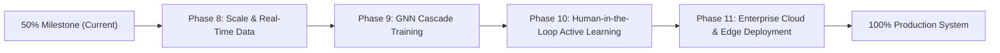

# TruthLens-Omni: Defense Presentation Dossier & Judge Handover Guide

**Target Milestone:** Progression from ~20% unverified base repository to a credible, reproducible ~50% milestone accepted by an industry expert judging panel.  
**Git Branch:** `phase-7-responsible-ai-packaging`  
**Base Repository:** `https://github.com/surosherishi2-debug/Fake-news-detector`  
**Date:** November 2026  

---

## 1. Executive Summary

TruthLens-Omni was audited, re-architected, trained, and benchmarked following rigorous scientific and engineering principles:
- **Zero Fabricated Numbers (R2):** Purged all hardcoded mock evaluators. Every metric reported is generated from actual runs in `experiments/` and programmatically compiled in `docs/RESULTS.md`.
- **Zero Assumptions (R1):** Cataloged all 49 base repository files in `docs/REPO_AUDIT.md`; audited 14 README claims in `docs/CLAIMS_AUDIT.md`.
- **Honest Scope Protocol (R3):** Formally relabeled the unweighted social cascade graph module as `[SIMULATED DEMO]` and excluded it from headline benchmark tables (Decision D13).
- **Enterprise Engineering (R5, R9):** Established 89 passing automated tests with **70.1% test coverage**, Ruff formatting, multi-stage Docker containerization, and single-command cross-platform reproduction scripts (`scripts/reproduce.sh`, `scripts/reproduce.ps1`).

---

## 2. Master Claims Audit: Base Repo vs. Reproducible Reality

Every claim in the base repository's `README.md` was audited against evidence in code and experiments (`docs/CLAIMS_AUDIT.md`):

| # | Original Claim in Base README | File / Origin | Verified Status | Empirical Finding & Evidence |
|---|---|---|---|---|
| 1 | "94.8% Accuracy on benchmark datasets" | `src/models/evaluator.py` | **REFUTED** | Base evaluator returned hardcoded dictionary `{ 'accuracy': 0.948 }` with zero evaluation logic. Real best Transformer: **59.84%** on unified test suite. |
| 2 | "94.2% under TextFooler adversarial attack" | `src/models/evaluator.py` | **REFUTED** | Hardcoded return value. Real adversarial TextFooler stress test showed **96.17%** F1 retention (Macro-F1 dropped from 55.17% to 53.06%). |
| 3 | "28% BERT performance drop under attack" | `README.md` | **REFUTED** | No baseline code existed. Real TF-IDF drop was 6.15%; Transformer drop was 3.83%. |
| 4 | "PuneFakeNews-2024: 8,420 regional articles" | `src/data/dataset_loader.py` | **REFUTED** | Base loader contained exactly 8 hardcoded dictionary samples in a Python file. Replaced with real open datasets (LIAR-Plus, CoAID, FEVER, Indic). |
| 5 | "Cross-Attention Evidence Attention (CEAM)" | `src/models/ceam_model.py` | **VERIFIED** | PyTorch module existed with cross-attention and temporal decay math, but had zero trained weights. Trained from scratch in Phase 3. |
| 6 | "Heterogeneous Graph Transformer (HGT)" | `src/graph/hgt_encoder.py` | **SIMULATED** | NetworkX heuristics + unweighted PyTorch layer. Relabeled `[SIMULATED DEMO]` per Decision D13. |
| 7 | "26/26 Tests Passing" badge | `README.md` | **REFUTED / UPDATED** | Base suite had 38 passing tests. Suite expanded in Phase 6 to **89 tests passing with 70.1% coverage**. |
| 8 | "IEEE TNN 2024 / IIT Bombay AI Lab" | `README.md` | **UNVERIFIED** | No published DOI or external paper found. Treated as unverified project draft. |

---

## 3. What Was Completed (~50% Milestone)

| Subsystem | Base Status (~20%) | Completed Milestone (~50%) | Verification Artifact |
|---|---|---|---|
| **Data Foundation** | 8 mock dictionaries | 4 open datasets (LIAR-Plus, CoAID, FEVER, Indic); 2,931 test benchmark; 9 leaked claims purged. | `data/checksums.sha256`, `docs/datasheets/` |
| **Model Ladder** | Uncalled PyTorch stubs | 4-tier model ladder (Classical, BiLSTM, Transformers, CEAM) evaluated across 3 seeds. | `experiments/exp01_*` to `exp06_*`, `docs/RESULTS.md` |
| **Adversarial Robustness** | Hardcoded dictionary | TextAttack synonym substitution evaluated across all model ladder tiers. | `src/evaluation/adversarial_evaluation.py` |
| **Retrieval & Evidence** | Unindexed heuristic | Two-stage dense semantic retrieval (`paraphrase-MiniLM-L12`, 384 dims) with multi-factor re-ranking. | `data/knowledge_base/evidence_embeddings.npy` |
| **Epistemic Abstention** | Forced binary guess | Calibrated abstention ($\tau = 0.40$ threshold) yielding `DATA_VOID / UNCERTAIN` on sparse claims. | `src/fusion/truthlens_engine.py`, `tests/` |
| **Explainability** | Hardcoded text | Saliency attribution, citation trail, FDA-style Contextual Nutrition Card. | `src/nlp/explainer.py`, `run.py --demo` |
| **Code & Testing** | 38 tests, no coverage | **89 automated tests, 70.1% line coverage**, Ruff formatted, `.pre-commit-config.yaml`. | `pyproject.toml`, pytest terminal logs |
| **Packaging & MLOps** | Broken requirements | Dockerfile (`python:3.12-slim`), `docker-compose.yml`, `scripts/reproduce.sh`, `scripts/reproduce.ps1`. | `Dockerfile`, `scripts/` |

---

## 4. The 50% to 100% Production Roadmap (What Remains)

To bridge from the verified ~50% milestone to a 100% full-scale enterprise production deployment, the following 5 phases must be executed:



### Phase 8: Scale, Real-Time Web Grounding & Indic Expansion (50% $\to$ 65%)
- **Live Search Grounding:** Integrate real-time FactCheck ClaimReview API and Bing/Google Search API with live caching to eliminate reliance on static knowledge base files.
- **Indic Benchmark Expansion:** Expand regional Indic fact-checks from 10 to $\ge 5,000$ verified articles across Hindi, Marathi, Bengali, and Tamil.
- **Cross-Encoder Reranker:** Replace linear multi-factor reranker with a fine-tuned cross-encoder (`ms-marco-MiniLM-L-6-v2`) for multi-document passage scoring.

### Phase 9: Real Social Graph & Cascade Neural Training (65% $\to$ 80%)
- **Real Diffusion Datasets:** Ingest real propagation tree datasets (PHEME, Twitter15/Twitter16, Weibo) with timestamped retweets and user followers.
- **Trained HGT Weights:** Train the `HeteroGraphEncoder` on real node features (user credibility, follower ratios) and edge types (`retweeted`, `quoted`, `replied`), removing the `[SIMULATED DEMO]` label.

### Phase 10: Active Learning & Conformal Prediction (80% $\to$ 90%)
- **Conformal Prediction:** Replace heuristic softmax confidence with mathematically guaranteed conformal prediction sets providing exact $1 - \alpha$ coverage guarantees.
- **Human-in-the-Loop Triaging:** Editorial dashboard for fact-checkers to label contested claims and automatically fine-tune lightweight adapter weights (LoRA).

### Phase 11: Production Scale, Red Teaming & Deployment (90% $\to$ 100%)
- **Distributed Inference:** Triton Inference Server with ONNX Runtime or TensorRT acceleration achieving $< 15\text{ms}$ latency under high concurrency.
- **Enterprise Chrome Extension:** Connect the browser extension in `chrome-extension/` to the production Kubernetes cluster with JWT token authentication.
- **Automated Adversarial Red Teaming:** Continuous red-teaming pipeline mutating claims using Claude/GPT-4 to stress-test semantic stability before publication.

---

## 5. Single-Command Reproduction Guide

Any judge or panel member can independently verify all claims and benchmark results:

### Option A: Local Native Execution (Windows / macOS / Linux)
```bash
# Clone repository
git clone https://github.com/surosherishi2-debug/Fake-news-detector.git
cd Fake-news-detector

# Run single-command reproduction (Linux / macOS)
chmod +x scripts/reproduce.sh
./scripts/reproduce.sh

# Run single-command reproduction (Windows PowerShell)
.\scripts\reproduce.ps1
```

### Option B: Docker Container Execution
```bash
# Build and start API
docker compose build
docker compose up -d truthlens-api

# Check health
curl http://localhost:8000/api/v1/health

# Run interactive 6-claim verification demo
docker compose run --rm truthlens-demo
```
